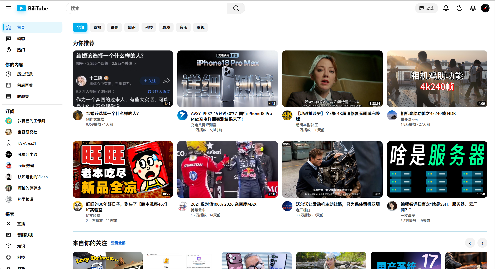
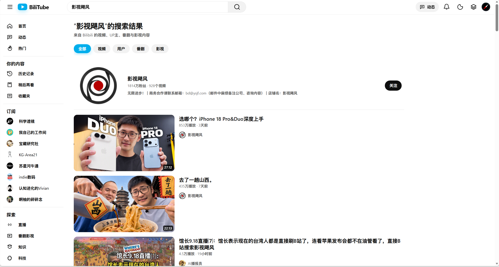

<p align="center">
  
</p>

<h1 align="center">BiliTube</h1>

<p align="center">给 B 站网页版加上 YouTube 式布局</p>

<p align="center"><sub>A Chrome / Edge extension that adds a YouTube Desktop-style layout to Bilibili.</sub></p>

<p align="center">
  
  
  
  
</p>

如果你平时用 YouTube 更多，切回 B 站网页版会不太顺手：首页是一条居中的窄栏，窗口拉宽以后两侧全空着；视频页的简介、评论和相关推荐都挤在播放器下面，得一路往下滚。

BiliTube 在 B 站网页版外面加一层 YouTube Desktop 式的界面：左侧常驻导航、跟着窗口宽度铺开的推荐网格、视频页双栏（播放器在左，信息栏在右），以及缩略图的悬停预览。首页、搜索、动态、频道这些外层页面都按同一套几何重排。

当前源码版本：`0.12.6`。不依赖 npm 或 bundler，仓库目录本身就是可加载的未打包扩展。

## 装上之后

截图是在宽屏窗口下实际渲染的，用来说明页面结构，不代表固定的推荐内容或接口返回值。

<p align="center">
  
  
</p>

<p align="center"><sub>首页：左侧常驻导航，推荐流按窗口宽度铺成多列　·　视频页：播放器与右侧信息栏并排</sub></p>

<p align="center">
  
  
</p>

<p align="center"><sub>动态：订阅时间线　·　搜索：结果网格与筛选栏</sub></p>

截图素材和隐私处理规则见 [`docs/screenshots/README.md`](docs/screenshots/README.md)。

## 功能范围

- 首页推荐网格、分类入口、关注/直播/番剧/热门内容 Shelf 和连续分页。
- 搜索建议、综合搜索、视频/用户/番剧/影视分类，以及标准浏览器链接行为。
- 视频搜索排序、时长筛选，以及直播和专栏原生搜索入口。
- 动态、频道、历史记录、稍后再看和收藏夹页面的桌面端布局。
- 在当前收藏夹中搜索视频，并按搜索结果继续分页。
- 普通视频页的双栏布局、侧栏抽屉、主题切换和作者信息镜像。
- 普通视频页按画面比例产生的播放器留白支持模糊填充，可在“播放与预览”设置中关闭；视频画面本身带有的黑边不在处理范围内。
- 缩略图 Hover Preview、预览进度条和“稍后再看”快捷操作。
- 外观、导航、首页内容、播放预览、动效、卡片信息、搜索和内容处理设置。
- 侧栏分区与创作服务入口、动态详情讨论、稍后再看列表移除，以及各替换页面的原生管理入口。
- 页面内内容刷新、分页失败重试和久置标签页的更新提示；刷新期间保留已有内容，旧请求不会覆盖新结果。

完整功能对应、分页策略与缓存上限见 [`docs/FEATURE_COVERAGE.md`](docs/FEATURE_COVERAGE.md)。

## 适合谁

- 主要用 YouTube，B 站只是偶尔看，不习惯首页那条居中窄栏——窗口越宽，两边空得越多。
- 想要深色主题和悬停预览这类桌面端才有的浏览手感。

反过来说，如果你想要的是一个独立桌面客户端，或者希望扩展接管播放器、弹幕、评论这类原生业务，BiliTube 不在这个范围内。

## 与 B 站原站的分工

首页、搜索、动态、频道、历史、稍后再看和收藏夹的 Shell、导航、卡片布局和分页状态由 BiliTube 负责；普通视频页调整 Header、侧栏和双栏几何，并可为播放器留白添加模糊填充。

播放器、播放控制、简介、评论、相关推荐、点赞投币分享这些仍由 B 站原生页面处理，扩展不代理请求、不合成点击事件。这种做法保留了登录态和原生业务能力，也让站点 DOM 或接口变化对扩展的影响小一些。

完整的页面能力对照见 [`docs/TECHNICAL_OVERVIEW.md`](docs/TECHNICAL_OVERVIEW.md)，路由策略和 Native-first 约束见 [`docs/ARCHITECTURE.md`](docs/ARCHITECTURE.md)。

## 安装

BiliTube 是加载解压扩展，不需要构建步骤。

1. 拿到扩展目录：到 [Releases](https://github.com/QuentinCrane/BiliTube/releases) 下载打包好的 zip 并解压，或执行 `git clone https://github.com/QuentinCrane/BiliTube.git`。
2. 打开 Chrome 或 Edge 的扩展管理页：`chrome://extensions` 或 `edge://extensions`。
3. 开启“开发者模式”，选择“加载已解压的扩展”。
4. 选择包含 `manifest.json` 的目录，不要选择 `src` 或 `assets` 子目录。
5. 重新打开 Bilibili 标签页；更新源码或重新加载扩展后，也建议重新打开已有页面。
6. 在扩展详情页打开“扩展选项”，按需调整界面和内容设置。

首次使用不需要创建 BiliTube 账号。公开首页和搜索内容可以直接浏览；历史记录、订阅、动态、稍后再看和收藏夹等能力取决于当前 Bilibili 登录状态。

## 界面语言

扩展使用 Chromium 原生 `_locales` 机制，根据浏览器界面语言显示中文或英文：

- `zh_CN`：默认语言，简体中文；浏览器语言不匹配下表时也回落到这一份。
- `en`：英文（English），覆盖设置页与 BiliTube 重绘的全部页面，界面文案不残留中文。

两套语言包保持相同的键集和占位符；计数型文案在英文下使用单数形式（`1 video` / `2 videos`），数字缩写按界面语言格式化（中文 `1.2万` / `1.2亿`，英文 `12.3K` / `1.2M`）。来自 Bilibili 自身的内容（视频标题、UP 主名、原站按钮等）仍保持原站语言。

语言设置由浏览器决定，不会额外保存账号或个人资料。修改浏览器语言后，重新加载扩展和设置页即可生效。

## English

BiliTube adds a YouTube Desktop-style layout on top of the Bilibili website in Chrome and Edge. You get a persistent left sidebar, a recommendation grid that follows the window width, a two-column watch page, and hover previews on thumbnails. Home, search, dynamics, channels, history, watch later and favorites are rearranged; the player, danmaku, comments and interaction buttons stay as Bilibili renders them.

The repository root is already the unpacked extension, so there is no build step. Download the zip from [Releases](https://github.com/QuentinCrane/BiliTube/releases) or clone this repository, then open `chrome://extensions` or `edge://extensions`, enable developer mode, and load the repository root as an unpacked extension.

The interface follows the browser language (`zh_CN` or `en`). The rest of this documentation is written in Chinese — [`docs/TECHNICAL_OVERVIEW.md`](docs/TECHNICAL_OVERVIEW.md) has the page capability map, and [`docs/ARCHITECTURE.md`](docs/ARCHITECTURE.md) covers the runtime structure.

## 验证

仓库没有必须执行的构建步骤。维护者可以在仓库根目录运行：

```powershell
node --test tests/*.test.js
node scripts/verify.mjs
git diff --check
```

前两条命令分别运行 Node.js 回归测试和 Manifest/资源/语法/架构校验。真实 Chrome 或 Edge 页面中的登录态、点击、导航和视觉结果仍需按照 [`PAGE_AUDIT.md`](PAGE_AUDIT.md) 手动检查。

## 项目结构

```text
.
├── _locales/              扩展界面翻译
├── assets/                扩展图标
├── docs/                  产品、架构、构建、测试、隐私和发布文档
│   └── screenshots/       README 和文档截图
├── scripts/               静态验证和 smoke 脚本
├── src/
│   ├── background.js      Manifest V3 service worker 与 Bilibili API
│   ├── core/              路由、数据、Shell、UI、Preview 和 Watch 运行时
│   ├── page/              页面桥接和 document_start 预布局
│   ├── options/           扩展设置页
│   └── styles/            预置样式和统一主题
├── tests/                 Node.js 回归测试和静态契约
└── manifest.json          Manifest V3 扩展入口
```

## 隐私与限制

BiliTube 没有自建服务器、账号系统、广告或云端同步。设置保存在浏览器的 `chrome.storage.local`，运行时缓存主要保留在内存中。扩展只访问 Manifest 中声明的 Bilibili 页面和资源域名，不向 BiliTube 自有服务上传用户数据。权限用途和数据边界见 [`docs/PRIVACY.md`](docs/PRIVACY.md)。

Bilibili 的页面 DOM、接口字段、WBI 参数和登录策略可能变化。未登录时，历史记录、动态、订阅、稍后再看和收藏夹可能为空。自动测试覆盖源码契约；当前浏览器和页面的实测结果记录在 [`PAGE_AUDIT.md`](PAGE_AUDIT.md)。

## 文档

- [`docs/BUILD_GUIDE.md`](docs/BUILD_GUIDE.md)：安装、开发循环、测试和发布包。
- [`docs/ARCHITECTURE.md`](docs/ARCHITECTURE.md)：运行时结构、路由策略和 Native-first 边界。
- [`docs/TESTING.md`](docs/TESTING.md)：自动测试与真实浏览器验收清单。
- [`docs/TECHNICAL_OVERVIEW.md`](docs/TECHNICAL_OVERVIEW.md)：页面能力、数据流和实现边界。
- [`docs/PRIVACY.md`](docs/PRIVACY.md)：权限和本地数据说明。
- [`CONTRIBUTING.md`](CONTRIBUTING.md)：贡献、测试和 Pull Request 约定。
- [`SECURITY.md`](SECURITY.md)：安全问题报告方式。
- [`CHANGELOG.md`](CHANGELOG.md)：版本变更记录。

## 许可与署名

BiliTube 使用 [MIT License](LICENSE)。版权署名为 `QuentinCrane`。Bilibili、YouTube 及相关商标和内容归其各自权利人所有；BiliTube 不代表 Bilibili 官方，也不改变 Bilibili 的服务条款。

```text
BiliTube — QuentinCrane
https://github.com/QuentinCrane/BiliTube
```

项目引用信息见 [`CITATION.cff`](CITATION.cff)。
